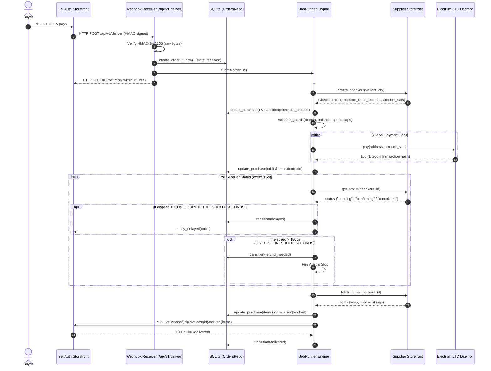

# System Architecture & Fulfillment Pipeline

## 1. End-to-End Sequence Diagram

---

## 2. Component Architecture

### Webhook Intake
- Handles incoming HTTPS requests on `POST /api/v1/deliver`.
- Enforces constant-time HMAC-SHA256 signature verification over raw incoming bytes.
- Guarantees immediate response (<100ms) to comply with SellAuth's 10-second timeout.
- Never holds HTTP connections open while waiting for cryptocurrency blockchain confirmations.

### Background Job Engine (`JobRunner`)
- Asynchronous task per order.
- Global serialization lock (`asyncio.Lock`) surrounding all `PaymentAdapter.pay()` calls to prevent concurrent wallet state corruption or double-spending.
- Crash recovery: On application startup, `runner.resume()` inspects non-terminal orders in SQLite and resumes fulfillment from their saved checkpoint.

### Fail-Closed Safety Matrix
- Any guard violation (e.g. margin below floor, float below reserve threshold, spend cap breach) immediately halts fulfillment and moves the order to `OrderState.REFUND_NEEDED`.
- Incomplete supplier deliverables (partial or 0 items) abort delivery and transition to `OrderState.REFUND_NEEDED`.
- Every transition writes an audit record to the `events` table atomically.

