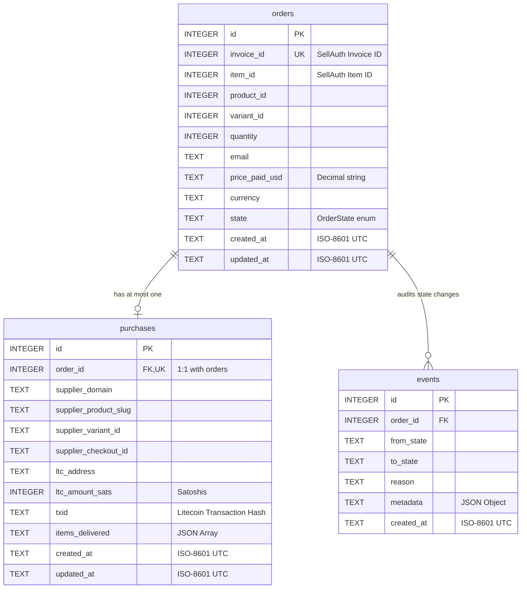
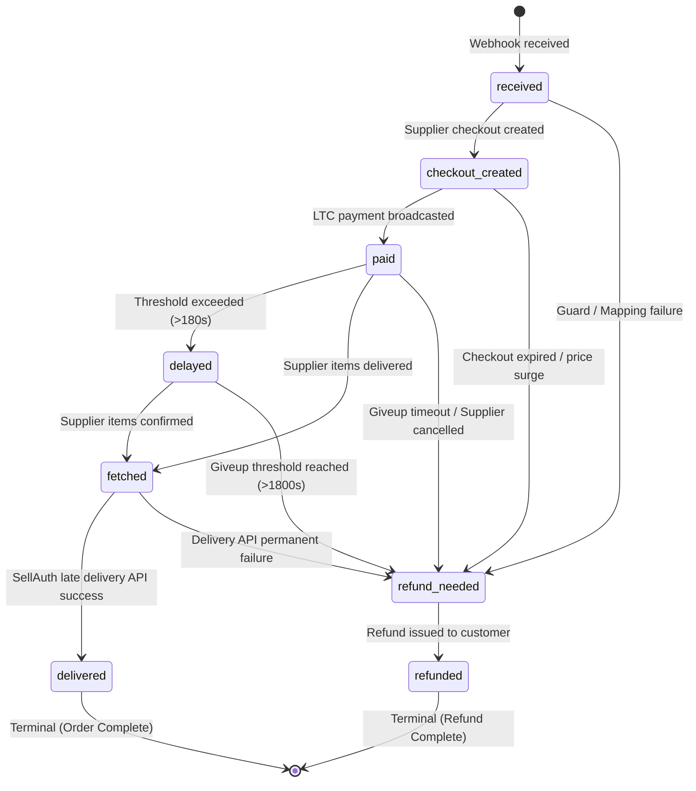

# Data Model & State Machine

## 1. Entity-Relationship Diagram

---

## 2. Order State Machine

---

## 3. Allowed Transitions Matrix (from `states.py`)

| Origin State (`from_state`) | Permissible Destination States (`to_state`) | Terminal? | Notes |
|:---|:---|:---:|:---|
| `received` | `checkout_created`, `refund_needed` | No | Initial state on webhook arrival |
| `checkout_created` | `paid`, `refund_needed` | No | Supplier checkout created & locked |
| `paid` | `delayed`, `fetched`, `refund_needed` | No | LTC transaction broadcasted |
| `delayed` | `fetched`, `refund_needed` | No | Buyer notified of confirmation delay |
| `fetched` | `delivered`, `refund_needed` | No | Deliverable items received from supplier |
| `delivered` | *(none)* | **Yes** | Items attached to SellAuth buyer invoice |
| `refund_needed` | `refunded` | No | Alert raised; requires manual/auto refund |
| `refunded` | *(none)* | **Yes** | Customer refunded |

---

## 4. Invariant Rules & Guarantees

1. **Idempotent Webhook Intake:**
   `orders.invoice_id` is indexed with a `UNIQUE` constraint. Duplicate webhook deliveries from SellAuth return the existing order without inserting duplicates or resetting progress.
2. **Strict Single-Purchase Guarantee:**
   `purchases.order_id` has a `UNIQUE` foreign key constraint. The repository enforces that no more than one purchase can ever be created for an order.
3. **Atomic Audit Logging:**
   Every transition in `OrdersRepo.transition()` updates `orders.state` and inserts an audit log row into `events` inside a single `BEGIN IMMEDIATE` SQLite transaction.
4. **WAL Mode & Busy Timeout:**
   SQLite connections operate with `PRAGMA journal_mode = WAL`, `PRAGMA foreign_keys = ON`, and a 5000ms `busy_timeout` to support high concurrency safely without table locks.

